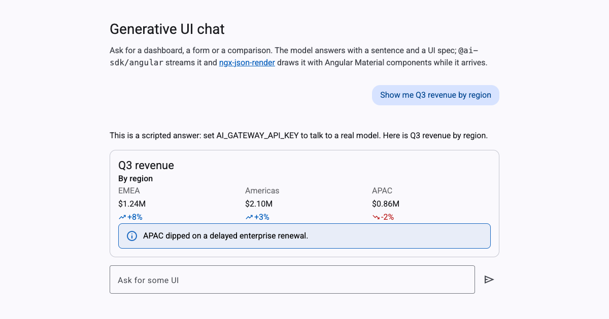

# Generative UI chat for Angular

An Angular chat where the model answers with **real Angular Material UI** —
dashboards, forms, comparisons — instead of only text. The Vercel AI SDK
streams the answer, and [ngx-json-render](https://github.com/shteynu/ngx-json-render)
renders the UI while it arrives. One Cloudflare Worker serves both the app
and the chat endpoint.

[](https://deploy.workers.cloudflare.com/?url=https://github.com/shteynu/angular-generative-ui-chat)

**Demo:** <https://angular-generative-ui-chat.angular-generative-ui-chat.workers.dev>



## What's inside

- **Angular 22**: standalone components, signals, zoneless, Angular Material 3.
- **`Chat` from `@ai-sdk/angular`**: the AI SDK's own Angular client, on a
  `DefaultChatTransport` pointed at `/api/chat`.
- **A Cloudflare Worker** (`worker/index.ts`) that serves the Angular build
  as static assets and answers `/api/chat` with `streamText` through the
  [Vercel AI Gateway](https://vercel.com/docs/ai-gateway), so any gateway
  model works with one key. Any other AI SDK provider works too.
- **ngx-json-render** with the
  [Material catalog](https://www.npmjs.com/package/ngx-json-render-material):
  the model may only use the components in the catalog, so it cannot inject
  markup or scripts. Nothing is rendered through `innerHTML` or `eval`.

## Deploy

Click **Deploy to Cloudflare** above: it copies the repository to your
GitHub account and deploys it with Workers Builds, so every push redeploys.
Or deploy from a clone:

```bash
npx wrangler login
npm run build && npm run deploy
```

The app works right away in demo mode: without a key, every question gets the
same recorded answer, and nothing is billed. To talk to a real model, add the
key as a secret, `npx wrangler secret put AI_GATEWAY_API_KEY` (or Worker →
Settings → Variables and Secrets). `MODEL`, a plain variable, picks the model
(default `anthropic/claude-sonnet-5.5`).

A deployed app is public, and every visitor's question is billed to your
gateway key. Put it behind
[Cloudflare Access](https://developers.cloudflare.com/cloudflare-one/applications/configure-apps/self-hosted-public-app/)
or your own login before you set a key on a public deployment.

## Run locally

```bash
npm install
cp .env.example .env   # optional: set AI_GATEWAY_API_KEY
npm start              # http://localhost:4200
```

`npm start` runs the Angular dev server and `server/index.ts`, a small Node
server that serves the same handler as the Worker. `ng serve` proxies `/api`
to it. `npm run preview` builds the app and runs the real Worker locally with
`wrangler dev`; it reads secrets from `.dev.vars`.

## How it works

1. **`server/chat.ts`** gives `streamText` the catalog's system prompt,
   `materialCatalog.prompt({ mode: 'inline' })`. It asks the model for a
   sentence of prose, then a ` ```spec ` fence of JSONL patches that use only
   the catalog's components.
2. **`pipeJsonRender`** from `@json-render/core` rewrites the stream on its
   way out: prose stays as text parts, and each patch line becomes a
   `data-spec` part of the message.
3. **`src/app/app.ts`** holds the `Chat`. **`src/app/chat-message.ts`** renders
   one message: `jsonRenderMessage(() => this.message().parts)` gives it the
   text and the spec rebuilt from the `data-spec` parts, and `<json-render>`
   draws the spec with `materialRegistry`.

`Chat` writes every chunk into one message object and hands back that same
object each time. A signal input holding it would never change, so
`App.messages` copies the message being written, which gives each chunk a new
value to pass down.

## Make it yours

- **Your own components.** Define a catalog of your components and their
  props with `defineCatalog`, register Angular components for them, and pass
  that catalog's prompt to `streamText`. See the
  [ngx-json-render README](https://github.com/shteynu/ngx-json-render/blob/main/projects/ngx-json-render/README.md).
- **Another provider.** Pass any AI SDK model, such as `anthropic('…')` from
  `@ai-sdk/anthropic`, to `streamText` in `server/chat.ts` instead of a
  gateway model id.
- **The recorded answer** lives in `server/scripted-model.ts`. Delete it and
  the fallback in `server/chat.ts` once you always run with a key.

## License

Apache-2.0
